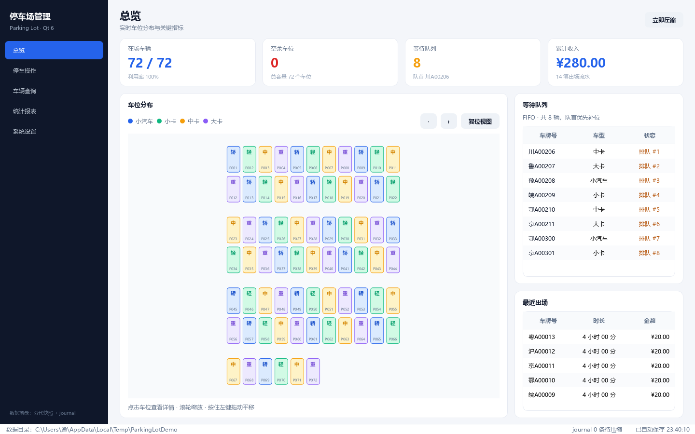
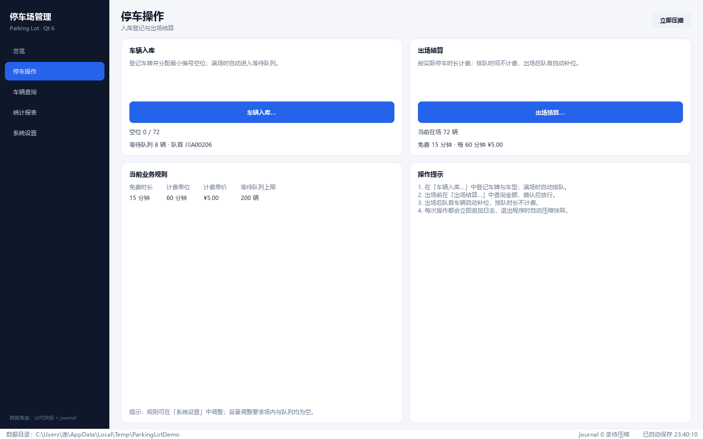
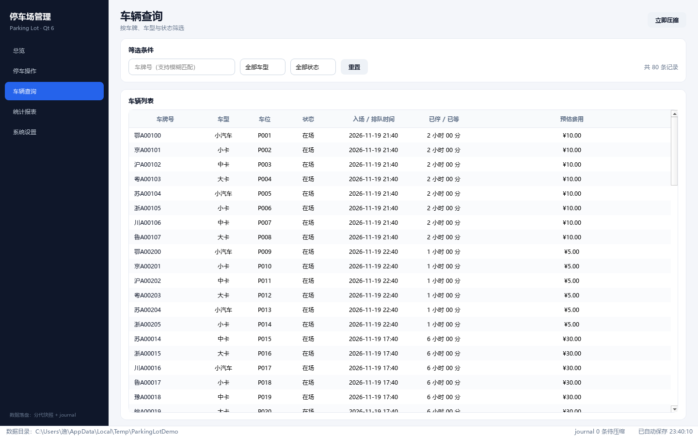
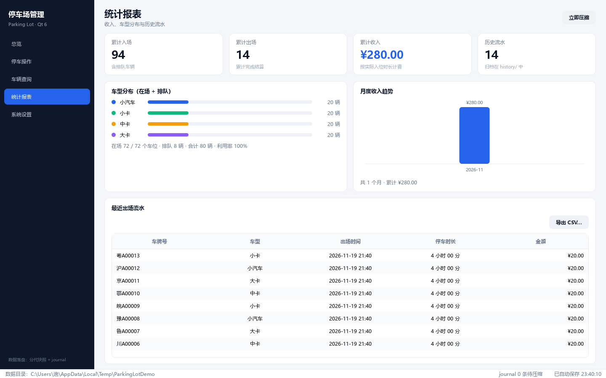
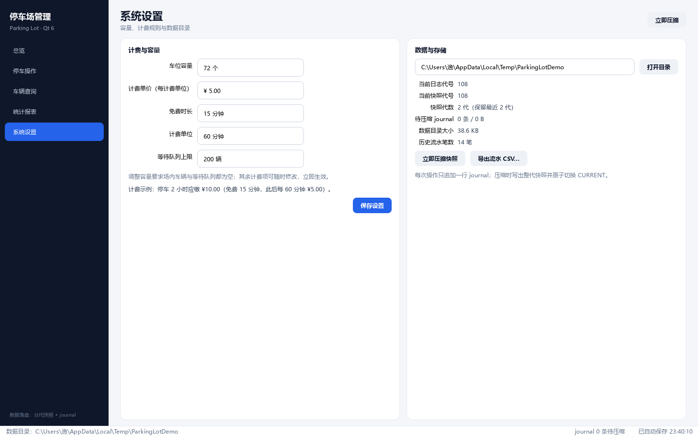

# 停车场管理系统（Qt 6 重写版）

> 原项目是华中科技大学 C 语言课程设计的「停车场管理系统」，用 C 结构体 + Qt Widgets 写成，
> 视图部分基于手写 OpenGL 3D，工程由 Visual Studio + Qt VS Tools 维护。
> 本仓库保留原项目作为纪念，并按 `docs/feasibility-2d-and-multifile-json.md`
> 的 P0–P5 计划重写为**纯 Qt 6 + CMake** 工程：删除 3D 视图与 VS 工程残留，
> 换成 2D 车位视图、分代快照 + 追加日志的存储层，以及可测试的领域模型。

## 界面

| 总览 | 停车操作 |
|---|---|
|  |  |

| 车辆查询 | 统计报表 |
|---|---|
|  |  |

| 系统设置 | 出场结算 |
|---|---|
|  |  |

## 相对原项目的结构性改动

| 原项目的问题 | 本项目的做法 |
|---|---|
| `car_ports[].state` 与 `vehicles_in_lot[]` 两份状态手工同步，可能不一致 | **单一真相源**：车位占用由 `active`（车牌 → 场内记录）推导，视图与统计都从它算 |
| 每次操作全量重写 `parking_data.txt`，写一半即损坏 | **分代快照 + `journal.ndjson`**：平时只追加一行，压缩时整代写盘并原子切换 `CURRENT` |
| `float unit_price` + `ceil(hours)`、`time_t` + `TIME_RATE=100` 魔数 | 金额统一 **int（分）**，时间统一 **qint64（毫秒）**，显示与计费同源 |
| 线性扫描找空位、`-1/-2` 魔数区分「不在场/在队列」 | `std::set<int>` 取最小编号空位，`EnterStatus/ExitStatus` 枚举语义化 |
| 手写 OpenGL 3D 视图：滚轮缩放失效、点选不中、黑屏风险 | **QGraphicsView**：命中测试 / 缩放 / 拖拽平移由框架提供，无 GL 上下文风险 |
| 5 个 Tab + 固定 768×576、每 5 秒清空表格重建 | 左侧导航 + `QStackedWidget`、可缩放窗口、`QAbstractTableModel` 增量刷新 |
| VS 工程 + GLEW NuGet 包 + 手写资源文件 | 纯 **CMake**（`Qt6::Core/Gui/Widgets/Test`），无 VS 扩展依赖 |

## 构建

**环境要求**

- Windows 10/11
- Visual Studio 2022（MSVC v143，含 CMake 组件即可，不需要 Qt VS Tools）
- Qt **6.10.3** `msvc2022_64`
- CMake ≥ 3.24

**一键构建**

```bat
build.bat                  :: Debug
build.bat -Config Release  :: Release
```

脚本会依次找 `cmake`（PATH 或 VS 安装目录）、校验 Qt 路径、配置并编译，
并自动执行 `windeployqt` 把 Qt 运行库与插件部署到 `build\<Config>\`——
因此 `build\Release\parking_lot.exe` 可以直接双击运行（加 `-Deploy:$false` 可关闭部署）。
若 Qt 不在默认位置，直接调用脚本并传参：

```powershell
.\scripts\build.ps1 -Config Release -Qt D:/Qt/6.10.3/msvc2022_64
```

**手动构建**

```powershell
cmake -S . -B build -G "Visual Studio 17 2022" -A x64 `
      -DCMAKE_PREFIX_PATH="D:/Qt/6.10.3/msvc2022_64"
cmake --build build --config Release
```

构建产物：`build/Release/parking_lot.exe`。

## 运行

**方式一：发行版（推荐，双击即可）**

```bat
package.bat
```

生成自包含目录 `dist\ParkingLotManagementSystem\`：内含 exe、Qt6 DLL、`platforms/` 等插件、
**VC++ 运行库**、README 与截图。双击其中的 `parking_lot.exe` 或 `run.bat` 即可运行；
也可以直接双击仓库根目录的 `run.bat`（尚未打包时会自动调用 `package.bat`）。

分发包：`dist\ParkingLotManagementSystem-Release.zip`，解压后是一个完整文件夹。
**不要只把 exe 单独拷走**——同目录的 `Qt6*.dll`、`platforms\`、VC 运行库缺一不可。

**方式二：开发调试**

`build\Release\parking_lot.exe` 依赖 Qt 的 `bin` 目录在 PATH 中，或用 `windeployqt` 部署到该目录：

```powershell
$env:PATH = "D:\Qt\6.10.3\msvc2022_64\bin;$env:PATH"
.\build\Release\parking_lot.exe
```

运行说明：

- 数据默认写到**可执行文件旁的 `data/`**，整个目录可随程序一起拷贝；
  若程序位于不可写目录（如 `Program Files`），自动回退到
  `%LOCALAPPDATA%\HUST\ParkingLotManagementSystem\data`。
- 命令行参数：

| 参数 | 说明 |
|---|---|
| `--data-dir <dir>` | 指定数据目录 |
| `--demo` | 向空库注入演示数据（72 位满场 + 8 辆排队 + 14 笔历史流水） |
| `--screenshot <dir>` | 渲染 5 个页面与对话框截图后退出（使用临时目录） |
| `--smoke` | 启动 1.2 秒后自动退出，用于冒烟检查 |

## 测试

```powershell
ctest --test-dir build -C Debug --output-on-failure
```

4 组测试全部通过（`domain` / `persistence` / `app` / `ui`）：

| 套件 | 覆盖内容 |
|---|---|
| `t_domain` | 计费边界（免费时长、计费单位进位）、满场排队、FIFO 补位、重复车牌、不变量校验、布局几何 |
| `t_persistence` | 快照往返、崩溃重放、残尾丢弃、快照全丢后按日志重建、归档幂等、旧代清理、损坏快照拒绝加载 |
| `t_app` | 应用上下文端到端：入场/出场/补位 → 落盘 → 重启恢复；配置修改与容量保护；CSV 导出 |
| `t_ui` | `offscreen` 平台构造主窗口、切换 5 个页面并渲染，不需要真实显示器 |

UI 测试里用到的 `--screenshot` 模式也用于生成 `docs/screenshots/` 中的图片。

## 打包

```bat
package.bat
```

产出 `dist/ParkingLotManagementSystem-Release.zip`：解压后为完整目录，内含 exe、
`windeployqt` 部署的 Qt 运行库与插件、**VC++ 运行库**、README 与截图，双击即可运行。

## 目录结构

```text
.
├─ src/
│  ├─ main.cpp                 程序入口（字体、翻译、命令行、截图模式）
│  ├─ domain/                  领域层：类型 / 计费 / 停车场 / 2D 布局（不依赖 Widgets）
│  ├─ persistence/             多文件 JSON 仓储：分代快照 + journal + 归档
│  ├─ app/appcontext.*         应用上下文：业务操作、失败回滚、单实例锁、演示数据
│  └─ ui/                      主窗口、主题、2D 视图、表格模型、5 个页面、2 个对话框
├─ tests/                      Qt Test：domain / persistence / app / ui
├─ resources/                  图标与 qrc
├─ docs/
│  ├─ feasibility-2d-and-multifile-json.md   可行性报告（P0–P5 计划与实测数据）
│  └─ screenshots/             界面截图
├─ prototype/                  原可行性验证原型（C++ 证据，非交付物）
├─ scripts/                    build.ps1 / package.ps1
└─ build_prototype.bat         重新生成原型与 out/report.md
```

## 存储设计（摘要）

```text
data/
├─ CURRENT                 当前快照代号（原子替换）
├─ journal.ndjson          上次快照之后的增量操作，一行一条
├─ history/YYYY-MM.ndjson  出场流水，按月分片，只追加
└─ gen-<seq>/
   ├─ config.json          容量 / 单价 / 免费时长 / 计费单位
   ├─ layout.json          2D 几何（派生，可随时重建）
   ├─ active.json          场内车辆 + 累计计数（权威）
   ├─ waiting.json         FIFO 队列（权威）
   └─ manifest.json        本代元信息
```

- **写路径**：业务操作 → 追加一行 journal（O(1)）→ 返回；压缩时归档流水 → 写整代 →
  原子切换 `CURRENT` → 清空 journal → 只保留最近 2 代。
- **读路径**：`CURRENT` → 加载该代 → 重放 `seq > snapshotSeq` 的日志 → 遇解析失败即视为残尾丢弃 →
  校验不变量（车位不重叠、空闲集合互补、队列 FIFO、车牌唯一）。
- 崩溃最坏只丢最后一次操作；单个 `CURRENT` 原子点保护一整组文件，不存在「车辆已出场但补位未入队」的混合状态。
- 每次写失败都会**精确回滚内存状态**，界面提示错误而不是假装成功。

细节与实测数据（写放大、启动耗时、崩溃矩阵）见
[`docs/feasibility-2d-and-multifile-json.md`](docs/feasibility-2d-and-multifile-json.md)。

## 功能对照

| 原功能 | 现在的位置 |
|---|---|
| 初始化车位数量 | 系统设置 → 车位容量（要求场内与队列为空） |
| 车辆入库 | 停车操作 → 「车辆入库…」对话框 |
| 车辆出库 / 取车 | 停车操作 → 「出场结算…」对话框（含明细与补位提示） |
| 查询车牌 / 车型 | 车辆查询（车牌模糊匹配 + 车型/状态过滤） |
| 保存 / 加载数据 | 自动：每次操作追加日志，启动/退出/阈值时压缩快照 |
| 修改单价 | 系统设置 → 计费单价 / 免费时长 / 计费单位 |
| 统计信息 | 总览 KPI 与统计报表 |
| 3D 图形视图 | **删除**，改为总览页 2D 车位视图（点击查看、滚轮缩放、拖拽平移） |

### 原功能验收对照

| # | 原功能 | 现状 | 验证 |
|---|---|---|---|
| 1 | 初始化车位数量 | 系统设置 → 车位容量（空场时） | `t_app/capacityGuard` + 手工 |
| 2 | 车辆入库 | 停车操作 → 入库对话框 | `t_app/enterExitAndReload` |
| 3 | 满场排队 | 自动进入 FIFO 队列 | `t_domain/queueLimit` |
| 4 | 出场计费 | 出场结算对话框（明细 + 金额） | `t_domain/feeBoundaries` |
| 5 | 队首自动补位 | 出场即补位，计费起点重置 | `t_domain/queueAndPromote` |
| 6 | 按车牌查询 | 车辆查询：车牌模糊匹配 | `t_ui` + 手工 |
| 7 | 按车型查询 | 车辆查询：车型 / 状态过滤 | `t_ui` + 手工 |
| 8 | 保存数据 | 每次操作追加 journal，无需手动保存 | `t_persistence` |
| 9 | 加载数据 | 启动时快照 + 重放日志 | `t_persistence` / `t_app` |
| 10 | 修改单价 | 系统设置：单价 / 免费时长 / 计费单位 | `t_app/configPersistedAcrossRestart` |
| 11 | 在场车辆表 | 车辆查询页（Model/View） | `t_ui` |
| 12 | 等待队列表 | 总览页右侧队列 | `t_ui` |
| 13 | 汇总统计 | 总览 4 个 KPI + 利用率 | `t_ui` |
| 14 | 车型分布 | 统计报表进度条 | `t_ui` |
| 15 | 图形视图交互 | 2D 视图：点选 / 缩放 / 平移 / 淡入动画 | `t_ui` + 手工 |
| 16 | 关闭再打开不丢数据 | 分代快照 + 崩溃重放 | `t_app/enterExitAndReload` |

## 已知取舍

- 排队时长不计费，补位时计费起点重置为入位时刻（决策 2）。
- 历史流水不自动清理，按月归档；统计页与 CSV 导出直接读取归档（决策 3）。
- 容量调整要求场内与队列均为空，避免在业务数据中间重建几何。
- 车牌只做长度与唯一性校验，不做号牌格式强校验。
- 单实例通过 `QLockFile` 保护：第二个实例只读打开，写操作被禁用。

## 原型与证据

`prototype/` 是按原报告写的不依赖 Qt 的原型，用来验证存储算法与 2D 布局；
`build_prototype.bat` 可重新生成 `out/report.md`（35 项断言）。
它**不是交付物**，正式工程的 JSON 由 `QJsonDocument` 实现、原子替换由 `QSaveFile` 实现，
但「分代目录 + CURRENT」的逻辑与原型一致。
