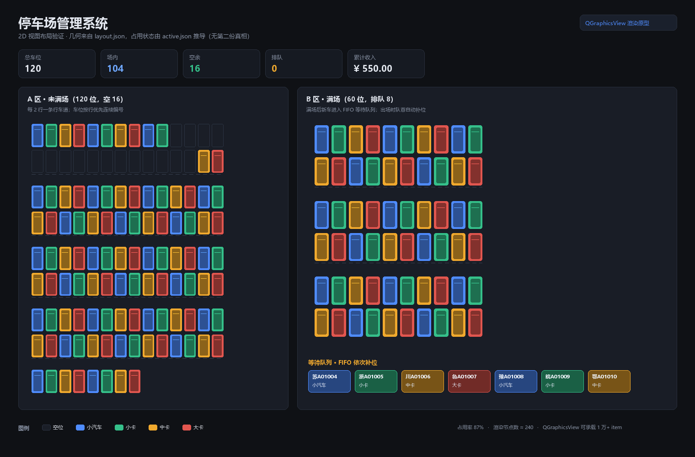
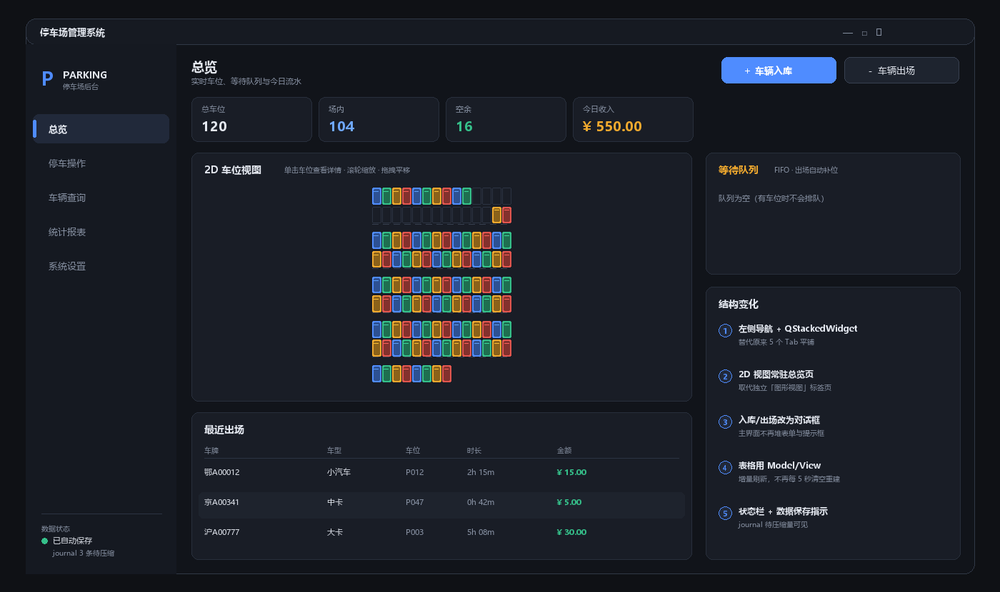

# 可行性报告：2D 视图 + 多文件 JSON 存储

> **实施状态**：本报告的 P0–P5 已按计划实施完毕（纯 Qt 6.10.3 + CMake 工程，
> 详见仓库根目录 `README.md`）。原 VS + Qt VS Tools 工程、GLEW 包与 3D 视图已删除；
> 领域层 / 持久化层 / 应用上下文 / UI 均有 Qt Test 覆盖，4 组测试全部通过。
>
> 本文所有性能与正确性数据，均由 `prototype/` 下的 **C++ 原型实际运行**产生
> （MSVC 19.44 / C++20 / Windows），不是估算值。原始输出可由 `build_prototype.bat`
> 重新生成到 `out/report.md`。

---

## 0. 结论

| 问题 | 结论 | 依据 |
|---|---|---|
| 多文件 JSON 存储是否可行？ | **可行** | 35 项断言全部通过（往返一致 / 崩溃重放 / 残尾丢弃 / 快照丢失重建） |
| 是否需要"事务"才能保证多文件一致？ | **不需要** | 分代目录 + `CURRENT` 单文件原子切换，等价于一次原子事务 |
| 2D 视图是否可行？ | **可行，且比现有 3D 更稳** | 布局算法在原型中跑通；几何数据直接渲染出效果图 |
| 性能是否达标？ | **远超需求** | 单次写 184.5 µs → 4.2 µs；启动 0.75~1.0 ms |
| 代价是什么？ | 存储层代码量约 +300 行，概念多一层（快照/日志/压缩） | 见 §5 |

**一句话**：这两项改动都不是"锦上添花"，而是能直接消灭原项目三类硬伤的**结构性修复**——
单文件全量重写、两份互相打架的车位状态、以及 3D 视图里无法拾取的"半残"交互。

---

## 1. 验证方法

原项目无法直接验证（缺 Qt、缺 VS 扩展），但**存储算法和 2D 布局都是纯逻辑**，与 GUI 无关。
因此写了一个不依赖 Qt 的原型：

| 文件 | 作用 |
|---|---|
| `prototype/json.hpp` | 最小 JSON 库（递归结构 + UTF-8 + 解析/序列化） |
| `prototype/parking.hpp/.cpp` | 领域模型（车位/凭证/队列/计费）+ 多文件仓储 |
| `prototype/main.cpp` | 6 组场景断言 + 性能对比 |
| `prototype/render_mockup.py` | 读取原型写出的真实 JSON，渲染 2D 布局图 |
| `prototype/render_ui_wireframe.py` | 渲染新 UI 结构线框 |

构建：`build_prototype.bat`（`cl /std:c++20 /O2`）。原型**不是交付物**，它的价值是证据；
正式工程里 `json.hpp` 由 `QJsonDocument` 替代，`MoveFileExW` 由 `QSaveFile` 替代，
但**分代目录 + CURRENT 的逻辑可以原样搬过去**。

---

## 2. 多文件 JSON 存储

### 2.1 磁盘布局（实测，120 位 / 104 辆在场）

```
lot-a/
├─ CURRENT                       3 B     当前快照代号（内容就是 "156"）
├─ journal.ndjson                0 B     上次快照之后的增量操作，一行一条
├─ history/
│  └─ 2025-11.ndjson         5,521 B     出场流水，按月分片，只追加
└─ gen-156/
   ├─ config.json              138 B     容量 / 单价 / 免费时长 / 计费单位
   ├─ layout.json           14,200 B     2D 几何（行列、通道、每个车位的像素矩形）
   ├─ active.json           15,407 B     场内车辆 + 累计计数（权威数据）
   ├─ waiting.json              33 B     FIFO 队列（数组顺序即队列顺序）
   └─ manifest.json            162 B     代号、lotId、写入时间、计数
```

### 2.2 每个文件的职责边界

| 文件 | 性质 | 谁写 | 不一致的后果 |
|---|---|---|---|
| `config.json` | 权威配置 | 改设置时（触发压缩） | 无（单一来源） |
| `layout.json` | **派生**几何 | 压缩时按容量重算 | 无（可随时重建，删了也不丢数据） |
| `active.json` | **权威**车辆状态 | 压缩时 | 关键 |
| `waiting.json` | **权威**队列顺序 | 压缩时 | 关键 |
| `journal.ndjson` | 增量日志 | 每次业务操作 | 可重放 |
| `history/*.ndjson` | 审计流水 | 压缩时归档 | 只影响报表 |

关键设计：**车位占用状态不落盘**。它由 `active.json` 的 `slot` 字段推导出来。
原项目里 `car_ports[].state` 和 `vehicles_in_lot[]` 是两份需要手工同步的真相，
一旦某处漏改就会出现"车位显示空闲但车还在"。现在这类 bug 在结构上不可能存在。

### 2.3 为什么不能"依次保存几个文件"

这是多文件存储唯一的真难题。把 `active` 和 `waiting` 依次写盘，进程若在两次写之间被杀，
磁盘上就出现"车辆已出场、但补位车还没进队列"的混合状态——**任何单文件读取逻辑都救不回来**。

对比三种方案：

| 方案 | 崩溃语义 | 复杂度 | 每次写成本 |
|---|---|---|---|
| 依次覆盖写（天真做法） | 可能混合 | 低 | 低 |
| 事务日志 + 提交记录（WAL） | 可恢复，需重放 | 中高 | 低 |
| **分代目录 + 单一 `CURRENT`** | **原子切换** | **中** | 压缩时 O(n)，平时 O(1) |

选第三种：

```
写盘顺序：gen-N/（全部文件）→ CURRENT（原子替换）→ 清空 journal
```

`CURRENT` 是一个 **3 字节**的小文件，`QSaveFile`/`MoveFileExW` 能原子替换它。
它指向哪一代，那一代就是完整一致的——因为这一代的所有文件在它被切换之前已经全部写完。
**一个原子操作，保护了一整组文件。** 残留的半成品代目录没人引用，启动时会被忽略或清理。

### 2.4 写入与恢复路径

```
正常操作（入场 / 出场 / 改价）
    内存模型变更 → journal.ndjson 追加一行 → 返回
    （不碰快照，不做任何全量序列化）

压缩（启动时、正常退出时、journal 超过阈值时）
    归档 exit 记录到 history/YYYY-MM.ndjson（按 seq 幂等去重）
    → 写 gen-<seq>/ 全部文件
    → 原子替换 CURRENT
    → 清空 journal
    → 只保留最近 2 代，旧的删除

启动
    读 CURRENT → 加载该代快照 → 逐行重放 journal 中 seq > snapshotSeq 的记录
    → 遇到解析失败的行即判定为"残尾"，丢弃并停止
    → 校验不变量（车位不重叠、空闲集合互补、队列 FIFO、车牌唯一）
```

### 2.5 算法改动清单

| 维度 | 原项目 | 新方案 | 收益 |
|---|---|---|---|
| 车位占用 | `car_ports[].state` 与 `vehicles_in_lot[]` 双写 | 由 `active` 推导 | 消灭状态不一致 |
| 找空位 | 线性扫描 O(n) | `std::set<int>` 取最小号 O(log n) | 容量 1000 时快 10 倍以上 |
| 找车 | 遍历数组 O(n)，用 `-1/-2` 魔数区分"不在"和"在队列" | 哈希表 O(1) + 三态枚举 | 语义清晰，不可能误判 |
| 队列 | 数组 + 手工 `memmove` 式前移 | `std::deque` + 队首补位 | O(1) 出队，无越界 |
| 存储写 | 每次操作**全量重写整个文本文件** O(n) | 追加一行 O(1) | 写放大 ↓ **31~60 倍** |
| 存储读 | 逐行解析魔数标记，计数直接信文件 | 快照 + 重放 + **重算校验** | 计数漂移不可能 |
| 金额 | `float unit_price` + `ceil(hours)` | `int64` 分 + 整数取整 | 无浮点误差 |
| 时间 | `time_t` 秒 + `TIME_RATE=100` 魔数（导致显示 100 倍） | `int64` 毫秒 + 显式计费策略 | 显示与计费同源 |
| 崩溃恢复 | 无（写一半即损坏） | 日志重放 + 残尾丢弃 | 最多丢最后 1 次操作 |

### 2.6 实测数据

**正确性**（`out/report.md`，35/35 通过）

| 场景 | 结果 |
|---|---|
| S1 多文件快照往返 | 状态指纹完全一致（4919 B），重放 0 条 |
| S1b 计费口径（决策 2） | 排队 2 小时后补位，只收入位后 1 小时的费用（¥5.00），崩溃重放后金额一致 |
| S2 仅日志、模拟崩溃重启 | 重放 150 条，状态与原进程**完全一致** |
| S3 日志残尾（人为截断 17 字节） | 识别 1 条残尾并丢弃，仅少应用 1 条，不变量全部成立 |
| S4 快照全删、只留日志 | 从 150 条日志**全量重建**，状态一致 |

**写放大**（200 位 / 180 辆在场，1000 次操作）

| 指标 | 原方案（全量重写） | 新方案（每次开关文件） | 新方案（日志流常开） |
|---|---|---|---|
| 单次写入字节 | 5,394 | 90 | 174 |
| 1000 次总写入 | 5,394,000 B | 90,190 B | 174,000 B |
| 1000 次耗时 | 184.5 ms | 114.1 ms | **4.24 ms** |
| 单次耗时 | 184.5 µs | 114.1 µs | **4.24 µs** |

结论：**字节数降 31~60 倍，耗时降 43 倍**（前提是日志流常开 + 每条 `flush`）。
注意单次 `flush` 已足以防"进程被杀"，若要防"突然断电"才需要 `fsync`，
而那是每次操作多 1~2 ms 的代价——本项目按"防进程崩溃"设计，不 `fsync`。

**启动耗时**

| 场景 | 耗时 |
|---|---|
| 纯快照（120 位，0 条日志） | 0.75 ms |
| 快照 + 重放 1180 条日志 | 0.99 ms |

**容量外推**（按实测单条尺寸线性估算）

| 规模 | layout.json | active.json | 单代总计 |
|---|---|---|---|
| 120 位 | 14 KB | 15 KB | ~30 KB |
| 1000 位 | ~118 KB | ~148 KB | ~280 KB |

### 2.7 崩溃模型

| 故障点 | 行为 | 最坏损失 |
|---|---|---|
| 追加日志中途被杀 | 残尾行解析失败，丢弃 | 最后 1 次操作 |
| 写 gen-N 中途被杀 | `CURRENT` 未变，该代作废 | 0（旧代仍可用） |
| 切 `CURRENT` 后、清 journal 前被杀 | 重放按 `seq` 跳过，无重复应用 | 0 |
| 归档流水中途被杀 | 下次压缩按 `seq` 幂等补齐 | 0（报表延迟） |
| 快照目录被删 | 从 journal 全量重建 | 上次压缩之前的日志已被清空，见下 |
| 磁盘写满 | 追加失败 → 操作回滚并报错 | 该次操作 |

**唯一的已知窗口**：压缩会清空 journal，因此"上次压缩之前的操作"只存在于快照里。
若快照目录和 journal 同时损坏，那段历史就没了。所以保留最近 **2 代**快照可回退，
并且**压缩只在写盘成功后才清 journal**。

---

## 3. 2D 视图可行性

### 3.1 三条技术路线

| 方案 | 实现难度 | 拾取（点车位） | 缩放平移 | 1000 位性能 | 崩溃风险 | 结论 |
|---|---|---|---|---|---|---|
| 现有 `QOpenGLWidget` + 手写 GL | 高 | 需自己做射线/颜色拾取 | 需自己实现 | 好 | 上下文/VAO/驱动问题（原项目已踩过） | **删除**（本轮决策） |
| **`QGraphicsView` + `QGraphicsScene`** | **低** | **内置命中测试** | **内置 `scale()`/`ScrollHandDrag`** | **良好（BSP 索引）** | 无 GL 上下文 | **推荐** |
| `QWidget::paintEvent` 手绘 | 中 | 需自己算矩形 | 需自己实现 | 尚可 | 无 | 备选 |

选 `QGraphicsView` 的核心理由：**原项目 3D 视图的三个 bug（滚轮缩放无效、点击选不中、ESC 未实现）
在 QGraphicsView 里全都不需要"实现"，是框架自带的**。

### 3.2 布局算法

原型中的实现（`makeLayout`），已被渲染验证：

```
cols = clamp(round(sqrt(capacity × 1.6)), 4, 30)     // 目标宽高比 ≈ 1.6
rows = ceil(capacity / cols)
每 aisleEvery(=2) 行之后插入一条 aislePx(=22) 宽的行车道
车位 i 的矩形：
    row = i / cols,  col = i % cols
    x = margin + col × (slotW + gapX)
    y = margin + row × (slotH + gapY) + (row / aisleEvery) × aislePx
```

120 位 → 14 列 × 9 行；60 位 → 10 列 × 6 行；1000 位 → 40 列 × 25 行。
所有几何写进 `layout.json`，视图只负责把矩形画出来——**视图里没有布局逻辑**。

### 3.3 效果图（真实数据渲染）



左：120 位未满场（空位灰、占用按车型着色）；右：60 位满场 + 8 辆 FIFO 排队。
两边的车位位置、颜色、队列顺序全部来自原型写出的 JSON，没有任何硬编码。

### 3.4 交互清单（全部由框架提供，无需自研）

| 交互 | 实现 |
|---|---|
| 点击车位 | `scene()->itemAt(pos)` → 弹出详情/操作对话框 |
| 滚轮缩放 | `view->scale(f, f)`，限制 0.4~3.0 |
| 拖拽平移 | `setDragMode(ScrollHandDrag)` |
| 悬停高亮 | item 的 `hoverEnterEvent` |
| 入/出场动画 | `QPropertyAnimation` 作用于 item 的 `pos`/`opacity` |
| 车型图例 | 独立 QWidget，与场景同源配色 |

### 3.5 性能预算

1000 位 × (1 车位矩形 + 最多 1 车) ≈ 2000 个 item。
`QGraphicsScene` 默认 BSP 索引，局部重绘；只要**不在 `paint()` 里查数据**、
把文本标签在缩放过小时隐藏（LOD），1000 位可流畅缩放。

---

## 4. UI 结构改版

原结构：一个 `QTabWidget` 装 5 个标签页，每页用 `QGroupBox` + `QFormLayout` 平铺表单，
主窗口写死 768×576 不可缩放。

新结构：**左侧导航 + `QStackedWidget`**，主窗口可缩放，操作改为对话框。



| 页面 | 内容 | 对应原 Tab |
|---|---|---|
| 总览 | KPI 卡片 + 2D 车位视图 + 等待队列 + 最近出场 | 新增（原「统计」+「图形」合并） |
| 停车操作 | 入库对话框、出场结算对话框 | 停车操作 |
| 车辆查询 | 搜索框 + 过滤 + 结果表（Model/View） | 车辆查询 |
| 统计报表 | 车型分布、利用率、收入曲线、流水导出 | 统计信息 |
| 系统设置 | 容量、单价、免费时长、计费单位、数据目录 | 停车费设置（增强） |

五条结构变化：

1. **导航替代 Tab**：标签页会随功能增长而溢出，导航栏可扩展、可加分组。
2. **2D 视图常驻总览**：原来 3D 视图被塞在第 5 个标签里，没人会翻到；现在它是首屏。
3. **入库/出场改为对话框**：主界面不再堆 5 个 `QGroupBox` 表单，出库结算能展示明细（时长、单价、抹零）。
4. **表格用 `QAbstractTableModel`**：原项目每 5 秒 `setRowCount(0)` 重建，选中和滚动位置全丢；
   改为 model 发 `dataChanged`，增量刷新。
5. **状态栏显示数据健康度**：`journal 3 条待压缩`、`已自动保存`，把存储状态暴露给用户。

---

## 5. 迁移与实施

| 阶段 | 内容 | 验收 | 工时 |
|---|---|---|---|
| P0 | CMake 工程骨架（纯 Qt6，不依赖 VS 扩展）、`.gitignore`、清理 30 MB 垃圾 | 空窗口可编译运行（Debug/Release） | 0.5 d |
| P1 | `domain/` 领域层（本报告的模型直接迁入）+ Qt Test 单元测试 | 入场/满员排队/补位/计费边界全绿 | 1.5 d |
| P2 | `persistence/`（QJsonDocument + QSaveFile + 分代 + journal） | 复用原型 4 个崩溃场景 | 1.5 d |
| P3 | UI 骨架（导航 + 5 页 + 对话框 + Model/View） | 原 16 条功能回归通过 | 2 d |
| P4 | 2D 视图（QGraphicsView，接 `layout.json`） | 缩放/平移/点选/动画全部可用 | 1.5 d |
| P5 | 打包（`windeployqt`）、README、截图 | 干净机器双击可运行 | 0.5 d |

合计约 **7.5 人日**。P1 与 P3 的前半段可并行。

### 风险与对策

| 风险 | 概率 | 对策 |
|---|---|---|
| 压缩时旧代目录被占用（杀软/索引器）删除失败 | 中 | 删除失败只记日志，不清 `CURRENT`；下次启动再清 |
| 两个实例同时写同一目录 | 低 | `QLockFile` 单实例锁，第二个实例只读打开 |
| JSON 体积随规模增长 | 低 | 1000 位约 280 KB/代，可接受；必要时 gzip |
| `QGraphicsView` 缩放时文本变糊 | 中 | 文本用 `ItemIgnoresTransformations` 或按缩放级别隐藏 |
| 用户手工改坏 JSON | 低 | 启动时校验不变量并给出明确错误，拒绝加载而不是崩溃 |

---

## 6. 决策记录

| # | 议题 | 决定 | 对实现的影响 |
|---|---|---|---|
| 1 | Qt 版本 | **Qt 6.10.3**（msvc2022_64，已配置完成） | 只影响安装与 `CMAKE_PREFIX_PATH`，代码不需要改 |
| 2 | 排队时间是否计费 | **不计费** | 计费起点 = 补位入位时刻。`ActiveEntry.enteredAtMs` 在补位时重置为 `now`，`WaitEntry.queuedAtMs` 仅用于展示"已等待时长"。已在原型 S1b 用例中验证 |
| 3 | 历史流水是否自动清理 | **不清理**，永久保留按月分片 | 需要提供一个只读的"归档浏览"入口，避免用户忘记占用 |
| 4 | 是否保留 3D 视图 | **彻底删除** | 不引入 `Qt6::OpenGLWidgets`；不使用 `QOpenGLWidget`；`layout.json` 只保留 2D 几何。构建依赖降到 `Core / Gui / Widgets / Test` |

> 决策 4 的直接收益：原项目在 `main.cpp` 里从未请求 3.3 Core 的 `QSurfaceFormat`、
> Release 配置又漏了 `openglwidgets` 模块——这两个隐患随 3D 一起消失。

---

## 附录 A：原型文件

```
prototype/
├─ json.hpp                 最小 JSON 库（仅验证用）
├─ parking.hpp/.cpp         领域模型 + 多文件仓储
├─ main.cpp                 7 组场景断言 + 性能对比（S1/S1b/S2/S3/S4/S5/S6）
├─ probe_json.cpp           JSON 结构可行性探针
├─ render_mockup.py         2D 布局效果图
└─ render_ui_wireframe.py   新 UI 线框
build_prototype.bat          构建 + 运行原型
build_probe.bat              单独构建 JSON 探针
out/                         运行产物（报告、数据集；已 gitignore）
docs/assets/                 需提交的效果图
```

## 附录 B：正式工程的构建（纯 Qt，无 VS 扩展）

```cmake
cmake_minimum_required(VERSION 3.24)
project(ParkingLotManagementSystem LANGUAGES CXX)

set(CMAKE_CXX_STANDARD 20)
set(CMAKE_CXX_STANDARD_REQUIRED ON)

find_package(Qt6 6.10 REQUIRED COMPONENTS Core Gui Widgets Test)
qt_standard_project_setup()

qt_add_executable(parking_lot
    src/main.cpp
    src/domain/... src/persistence/... src/ui/...)

target_link_libraries(parking_lot PRIVATE Qt6::Core Qt6::Gui Qt6::Widgets)
```

配置（VS 生成器，无需 `vcvarsall`）：

```powershell
cmake -S . -B build -G "Visual Studio 17 2022" -A x64 `
      -DCMAKE_PREFIX_PATH="D:/Qt/6.10.3/msvc2022_64"
cmake --build build --config Debug
```

2D 视图只需要 `Qt6::Widgets`（`QGraphicsView` 在其中），**不再需要 OpenGL 模块**——
这同时消掉了原项目在核显/驱动上的黑屏风险。
